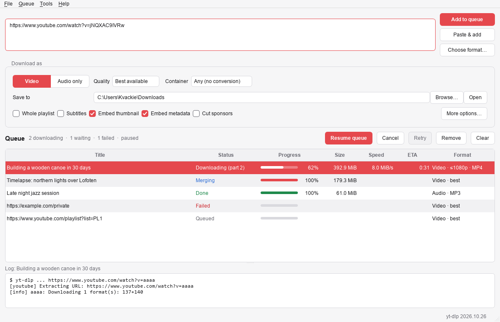

# yt-dlp GUI

A desktop app for downloading video and audio with [yt-dlp](https://github.com/yt-dlp/yt-dlp), from
YouTube and [the thousands of other sites](https://github.com/yt-dlp/yt-dlp/blob/master/supportedsites.md) it supports.

It is a **single file** for Windows and Linux (Debian 12 and newer). There is nothing to install: on
first start it downloads yt-dlp, FFmpeg and Deno for you and keeps them up to date.



## Download

Get the file for your system from the [latest release](../../releases/latest):

| System | File |
| --- | --- |
| Windows 10/11 (64-bit) | `ytdlp-gui-windows-x64.exe` |
| Linux x86-64 (Debian 12+, Ubuntu 22.04+, …) | `ytdlp-gui-linux-x86_64` |

- **Windows:** double-click the `.exe`. SmartScreen may warn about an unrecognized app the first time:
  choose *More info → Run anyway*.
- **Linux:** make it executable once, then start it:
  ```bash
  chmod +x ytdlp-gui-linux-x86_64
  ```
  Afterwards *Tools → Add to the applications menu* gives it a menu entry and icon.

## What it does

- **Paste and go:** paste one or many links (or drag them onto the window) and they download in the
  background, a few at a time.
- **Video or audio:** best quality or capped at 2160p / 1440p / 1080p / 720p / …, as MP4, MKV or WebM;
  or audio only as MP3, M4A, Opus, FLAC or WAV.
- **Choose the exact format:** *Choose format…* lists every stream a video offers so you can pick one
  (or a video plus an audio stream).
- **Playlists and channels** go into their own folder, numbered; pick items such as `1-10,15`.
- **Extras:** subtitles (embedded or as files), thumbnails and metadata in the file, chapters,
  SponsorBlock cutting, browser cookies for age-restricted or members-only videos, speed limit, proxy,
  "skip what I already downloaded", custom file names, and any other yt-dlp option you want to add.
- **Queue that survives restarts:** unfinished downloads pick up where they left off next time.
  *Pause queue* lets running downloads finish but starts no new ones until you resume it.
- Light and dark theme, optional clipboard watching.

## The tools it manages

| Tool | Why | Where it comes from |
| --- | --- | --- |
| yt-dlp | the downloader itself | [yt-dlp releases](https://github.com/yt-dlp/yt-dlp/releases) (stable, nightly or master channel) |
| FFmpeg | merging video and audio, converting, embedding | [yt-dlp's FFmpeg builds](https://github.com/yt-dlp/FFmpeg-Builds) |
| Deno | JavaScript runtime yt-dlp needs for full YouTube support | [Deno releases](https://github.com/denoland/deno/releases) |

Every download is checked against the checksums published with the release before it is used.
By default the app looks for updates when it starts and installs new yt-dlp and Deno versions by itself
(after running downloads finish); FFmpeg updates are offered under *Tools → Tools & updates*, where you
can also switch yt-dlp to the nightly channel when a site breaks. If FFmpeg or Deno are already installed
on your system (e.g. `apt install ffmpeg`), those copies are used and not downloaded again.

The app updates itself the same way: when a new release is out, *Tools → Tools & updates* offers it;
the new version replaces the executable in place and is used after a restart.

## Where things are kept

The app is fully portable. Settings, the queue and the tools live in a `ytdlp-gui-data` folder that it
creates next to the executable; nothing is written to your user profile or the registry. Put the
executable in its own folder (or on a USB stick), and move or copy the two together. Deleting both removes
every trace.

The executable has to be somewhere you can write to; it tells you if it can't create its folder (e.g. in
`C:\Program Files` or `/usr/bin`).

## Troubleshooting

- **A download fails with "Sign in to confirm you're not a bot" or "This video is age-restricted":**
  choose your browser under *Preferences → Network → Cookies from browser*.
- **A site that used to work fails:** check for updates under *Tools → Tools & updates*, or switch the
  yt-dlp channel to *Nightly*.
- **Details:** select a download to see yt-dlp's complete output in the log below the queue.

## Building from source

See [docs/BUILDING.md](docs/BUILDING.md).
